# FIELD REPORT — range-day-seventeen — 27 Nov 2026

The workbench is live. On Dan's typed line ("yes, merge and deploy
range-day-seventeen, then merge its notes") pull request
[#60](https://github.com/isleofdan/range-day/pull/60) was merged as
`b21c9bc` and deployed (Deploy run 29,
[46069316724](https://github.com/isleofdan/range-day/actions/runs/46069316724),
green). Home now has a link **The workbench** beside **The book**, under
the two doors.

Executor: a Claude Code cloud session (Dan opened it; permission mode
Auto, read from the session). Independent checker: the Codex result
checker through the Spine tool `check_result` (verdict under "Verify
results"). This report, its 22 pictures and the `PLAN.md` note are in
the notes-only pull request
[#61](https://github.com/isleofdan/range-day/pull/61), after the deploy,
in the order `CLAUDE.md` fixes.

## What stands

- **The bench test's timing repair** (`test/bench.test.js`, commit
  `3674000`). The sign-in helper now waits for home's list of the whole
  rifle set, which home fills just after it writes the last-used rifle,
  before it clears the device. So that write can no longer land inside
  "verify 8"'s snapshot of the keys held before. On main, in this
  session's first full run, the test failed exactly that way
  (`range-day:last` expected `{"rifle":"bcm-ar15"}`, got
  `{"rifle":"iwi-x95"}`); on this branch it passed 20 runs out of 20.
- **The workbench's figures** (`data/workbench.json`, new, loaded and
  checked by `lib/data.js` like every data file; commit `f68b2b2`):
  - Speed per inch of barrel, per caliber: 5.56x45 25 feet per second
    (the figure the loads' own estimates already use), 7.62x39 20 (the
    same), 5.45x39 25 (an estimate: no 5.45 test was found; the 5.56 test
    and Hornady's "25 to 35 feet per second per inch"), 7.62x54R 25.7 (a
    University of South Florida test that cut a Mosin-Nagant barrel from
    28.75 to 16.75 inches), .22 LR 0 (an estimate: a standard-speed .22
    is fastest from about 16 to 18 inches and gains nothing from a longer
    barrel). Each has a sentence of its basis in plain words
    (`fpsPerInchWords`) that the workbench shows.
  - Barrel lengths per rifle, the rifle's own among them, each with its
    source: the BCM 14.5, 16, 18, 20 in; the Tavor SAR 16.5, 18; the X95
    16.5, 18.5; the 7.62x39 AK 16.3 only; the 5.45 AK 16.2, 16.3; the
    Vepr 16.5, 20.5, 23.2; the Remington .22 20, 24, 28.
  - Mounts per collection scope, the one it came in first: the two
    ACOGs, the TA51 (1.535 in over the rail) and the Q-LOC Extra High
    AC12044 (2.05); the Vortex, the CM-534 (1.574), the Pro Extended
    Cantilever (1.44), Pro Series rings Low 0.95, Medium 1.10, High 1.45,
    Precision Matched Low 0.92 and High 1.26; the Leupold, the Mark IMS
    (1.5) and Mark 4 High rings (1.06). Iron sights and sights fixed to a
    rifle offer no height.
- **The build record** (`public/builds.js` new, `public/game.js`,
  `docs/RECORDS.md` "The builds"; commit `e41984c`). A build is kept in
  one list under the key `builds`: an id (`b-` and letters), the name he
  typed, the rifle it is a version of, its barrel length, and the mount per
  scope where changed. On loading, each build joins the game's data as a
  rifle of its own under its id: the rifle's own entry with the barrel,
  each load's speed from that barrel and the mounted scope's height
  changed, nothing else. So a build's sight setting, zero, shot log, book,
  cold-bore record, zeroing supply and days are kept under the build's id
  in the very key shapes every rifle uses; no existing key changes
  meaning, and the rifle as fitted keeps its own. A new build starts
  unzeroed. Removing a build sets `removedAt` (off every list); **Put it
  back** clears it; nothing is ever deleted. The copy file carries the
  builds (optional, so an older copy still loads), and loading a copy adds
  the builds the device lacks; what "Load a copy" reports keeps its four
  counts as before, with the builds counted apart (commit `4672702`,
  after the day test's "verify 11" on the first Checks run held the old
  shape).
- **The workbench page** (`/workbench`, behind the sign-in, with the four
  install lines and the two crash-reporting lines that `public/index.html`
  carries; commit `22ca201`). Rifle, then barrel length (the length as
  fitted chosen, marked "(as fitted)"), then under **Scope mounts** one
  picker per collection scope the rifle takes (each mount as "1.535 in
  over the rail: Trijicon TA51 flat-top mount (as it came)"), then a name
  (offered from the change, e.g. "20 in barrel", until he types one) and
  **Make this build**, greyed until something differs from the rifle as
  fitted. **What this build changes** is a table, As fitted beside This
  build: barrel length, each load's muzzle speed, each sight's height over
  the bore, the changed rows marked; under it the speed rule in plain
  words and the mount change. **Your builds** lists each build under its
  rifle with its three doors (Zero bench, Firing line, The book) and
  **Remove**; removed ones stand under **Removed** with **Put it back**.
- **A build is usable wherever a rifle is** (commit `c6d3799`). Home, under
  the rifle buttons, shows "Version: As fitted" and one button per build
  of the picked rifle (nothing when it has none, so home looks as before);
  the doors then carry the build. The bench and the line take the load
  through `RD.loadFor`, which gives a build's speed for that load and, for
  a rifle as fitted, the load itself; the sight height comes from the
  build's own entry. Everywhere a rifle's name shows, a build shows as
  "BCM AR-15 carbine build “20 in barrel”, 5.56". The day's page,
  playback, the book and the copy file read a build's shots by its id.
- **The book's comparison** (commit `93eb2e6`, fitted to a phone in
  `00ce1af`). On a page of a rifle that has builds (or of a build), a
  section **Beside another version** with a picker (As fitted, or another
  build of the same rifle) and a table: Yards, this page's lines, the
  other's lines, each cell only his own unstruck book lines at that
  distance as the book already words them, blank where he has none.
- **README** (commit `229bf09`): a section "The workbench" in plain words.
- **Tests:** `test/workbench.test.js` (6, no browser) and
  `test/workbench-browser.test.js` (5, a browser that signs in through
  the form, the fifth for the copy file carrying a build); `test/fitted-strikes.json` holds main's strikes for verify 2.
- **Screens:** seven new screenshot states in `npm run screenshots`, each
  at 412×915, 378×762 and 1280×800 (`scripts/screenshots.mjs`; the
  378×762 size runs only for these states).

## UI review

Screens touched: the workbench (new), home (the Version row and the
workbench link), the book (the comparison). Pictures: "Verify results",
item 7.

1. **Speed of the frequent action** (making a build): the rifle is the
   last used, the barrel and every mount are the as-fitted ones, the name
   fills itself from the change: one change and one tap. Choosing a build
   on home is one tap on its button.
2. **Recovery:** Remove is undone by **Put it back** on the same page; a
   wrong build costs nothing (its records stay, unused); nothing is
   deleted. A build cannot be edited after making: make another (a
   divergence below).
3. **Finding the tool:** "The workbench" beside "The book" under home's
   doors, and on the open-day card; each build's three doors on the
   workbench; the comparison sits on the book page itself.
4. **Orientation:** every screen names a build as "… build “name”, …";
   home's Version row shows which version is picked; the comparison's
   headings say This build / As fitted.
5. **Feedback:** "Made “20 in barrel”. It starts unzeroed, and is under
   the BCM AR-15 carbine, 5.56 on home. Zero it at the bench." written
   from the store's own answer; a refused store says "not saved on this
   device" instead.
6. **Interruption:** none; nothing pushes, nothing nags.
7. **Thumb reach:** the Version buttons are 44 px tall; Make this build
   and each build's doors are full-width buttons; the mounts are folded
   under one line so the barrel and Make stay near the top. On home with a
   build, the doors sit about 45 px lower than without one (the Version
   row); at 412×915 the doors' bottom edge is then near the screen's
   foot.
8. **Defaults and prefill:** as fitted everywhere, the name from the
   change, the comparison opens beside the rifle as fitted.

Not added, and why: no editing a build (a build's records were fired
with its figures; changing them after would misfile them); no limit on
builds; no "best build" or totals (no game mechanics); no predicted figure
of any kind (the game never gives the drop). Which came from Dan's own
requests: 1 and 8 (making a build is "changing one thing and naming it",
from the brief Dan's planning chat wrote), and the comparison (6, "see
the effect on zero and hits").

## What the brief got wrong

- Section 1 names the branch `range-day-seventeen`; this cloud session may
  push only `claude/range-day-card-brief-w0mcee`, so the work is there.
- Verify 5 seeds "the seeds the day and bench tests already use": there is
  no shared seed of a whole player. The test uses the bench test's (a
  zero and a sight setting of the BCM, `test/bench.test.js` verify 8) and
  the playback test's day (`test/playback-seed.js`), packed up, plus one
  book line of that day.
- The brief check's findings (on the card before the brief) asked for this
  brief to be addressed to the rented Linux machine; Dan opened it in the
  cloud, as its own first paragraph says he chose, and the repository's
  rules make a hosted cloud session the default for new coding work. It
  ran here.

## Deliberate divergences

- **A build's records are keyed by its id, not the name he types.** The
  brief says "under the build's own name". A typed name can repeat, can
  hold a colon (the keys' separator) and could later be changed; the id
  cannot. The name shows everywhere the build is shown.
- **Lengths that make a short-barreled rifle are left out:** the BCM's
  11.5 and 12.5 in and Arsenal's 8.5 in 5.45 (sold, but a separate kind
  of rifle in US law). The 14.5 in BCM stays (a rifle with a muzzle device
  pinned on). Mounts at a height already offered are left out (the Q-LOC
  AC12042 at 1.535, the Leupold Mark AR and bolt-action Mark IMS at 1.5,
  the Vortex Precision Matched Extra-High at 1.45), and so are the two
  Leupold rings whose listed height may not be to the scope's center.
- **The 7.62x54R figure for builds is 25.7, not the 20 the Vepr's loads
  use** for their own adjustment from the makers' test barrels. 25.7 is a
  published cut-down test; the loads' figures are untouched so the Vepr as
  fitted strikes where it did.
- **A build has its own zeroing supply** (`supply:<build>:<load>`), as it
  has its own everything else.
- **Verify 5 leaves out the keys a visit rewrites by design** and says so:
  the last-used choices (`last`, `last:<rifle>`, `when`), the marker of
  the last packed-up day (`day:packed`, cleared by any new day) and the
  open day. Every record key (zeros, sight settings, days, book) is
  compared byte for byte. The build's day is left open, not packed up
  (packing up adds it to the shared list of finished days, which is the
  build's own day, not a change to an old one).
- **A screenshot state needed the BCM's book set aside.** In shard 3 an
  earlier state (book-several) leaves real hits on the BCM's book page,
  so "book-compare-empty" was not empty there; both comparison states now
  set that page aside while they run and put it back after (`cd24367`).
- **Verify 4 compares the line's strike with the engine run in the same
  browser.** Node's maths and the browser's differ in the 13th digit
  (−30.156099422885017 against −30.156099422885188), so the test also
  checks Node's engine agrees within a billionth of an inch.

## Verify results

1. **Tests.** On `main` (`2903ab9`), before any change, without the
   browser: 178 tests, 102 passed, 76 skipped (the browser tests), 0
   failed. With this machine's browser pointed at them, main's first full
   run failed the bench test's "verify 8" in exactly the way step 1 fixes;
   a second, clean run of main reached 125 of 178 tests before its time
   limit (120 passed; 5 playback and same-scale tests failed on main's own
   code: this container draws the 3D scenes in software and is too slow
   for them), so the full proof is the repository's Checks workflow, which
   splits the suite over 13 jobs. On this branch: 189 tests (178 + 11
   new). Checks run 46060785591 on `4672702`: all 9 test groups passed;
   screenshot shards 1 and 2 passed, shard 3 failed on a new state of
   mine (fixed in `cd24367`; the cause is under Deliberate divergences). Final run on `cd24367`,
   [46063118874](https://github.com/isleofdan/range-day/actions/runs/46063118874): all 13 jobs passed
   (the 9 test groups and the 4 screenshot shards).
   Step 1's test: 20 passes out of 20 runs.
2. **Nothing moved for the rifles as fitted** (`test/workbench.test.js`,
   "verify 2"): for each of the seven rifles with its default sight and
   first load, the engine's strike at 100, 300 and 600 yards (the bench's
   own call, the sight at its middle, no wind, a seeded draw) is main's to
   every digit, for example the BCM at 600 yd −148.39236813098148 in up,
   9.066271701154939 in right; the .22 at 600 yd −1005.9581946033571 in.
   The figures from main are in `test/fitted-strikes.json`.
3. **A build's speed follows the rule:** the workbench shows IMI M193 at
   "3,066 feet per second" as fitted and "3,166 feet per second" with
   20 in; the line's engine input that day was 3,148.00 at 52 F, which is
   3,166 at the load's 70 F moved by the engine's own temperature rule;
   `public/builds.js` gives 3,166 for the 20-inch build of the BCM.
4. **A build's shot is the engine's shot:** the 20-inch BCM with the
   Vortex in low rings (2.16 in over the bore): at the bench, the hole
   −8.42, 0.22 in, the engine's figure −8.42, 0.22 in (the rifle as fitted
   would have put it at −9.18 in up); on the line at 300 yd,
   −30.340843759462278 in up, 2.477069687783182 in right, 0.3500089706329484 s,
   the engine's the same to every digit.
5. **Old records untouched:** keys held before (4), each the same after:
   the Vepr's book page, the finished days, the BCM's sight setting and
   zero. Keys the build added: its book, log, sight setting, zeroing
   supply and zero, and `builds`.
6. **No drop:** with no shots, the workbench's words carry no drop,
   come-up, minutes of angle, clicks or landing, and every number in its
   tables is a barrel length, a load's speed or a height; the comparison
   shows "No hits on steel yet with either". With lines: 300 yd, this
   build "5.32 minutes of angle up from the 100-yard zero, 60 F", as fitted
   "6.65 …"; 500 yd, this build blank, as fitted "15.96 …".
7. **Screens** (all fit the width at each size; files in
   `docs/reports/screenshots/`, `<state>-phone.png` 412×915,
   `-small.png` 378×762, `-computer.png` 1280×800): `workbench-empty`,
   `workbench-changed`, `workbench-made`, `workbench-removed`,
   `home-build-chooser`, `book-compare-empty`, `book-compare`.

   | State | 412×915 | 378×762 | 1280×800 |
   | - | - | - | - |
   | the workbench, no builds | 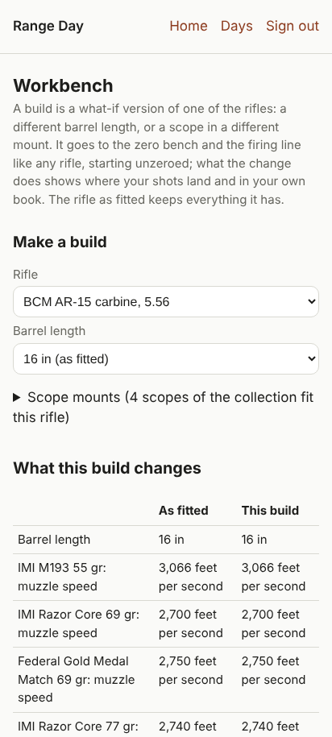 | 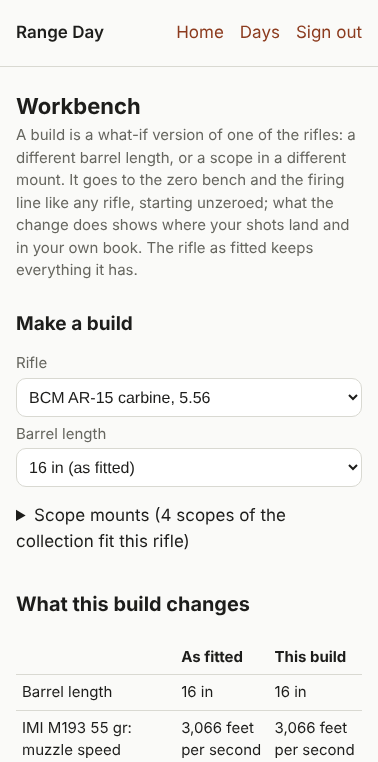 | 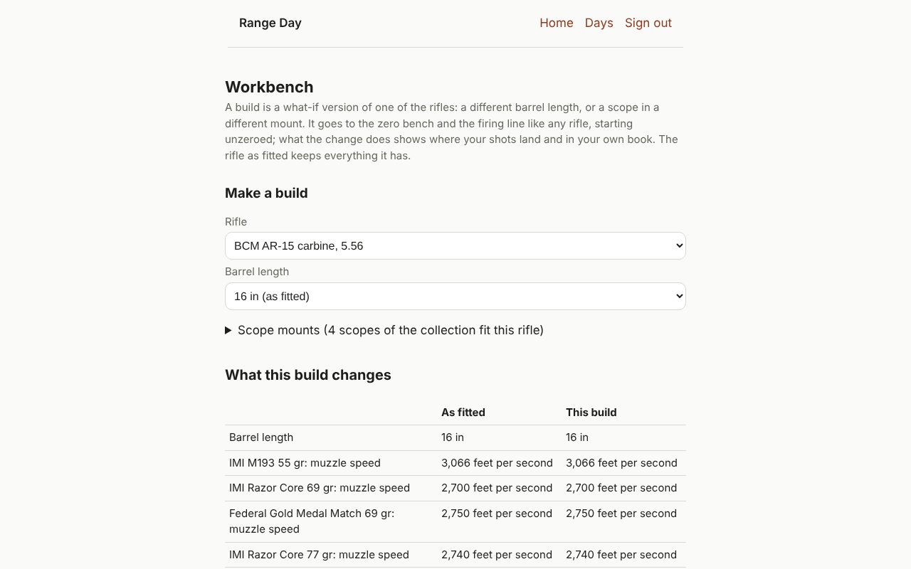 |
   | a change made: 20 in barrel, the Vortex in low rings | 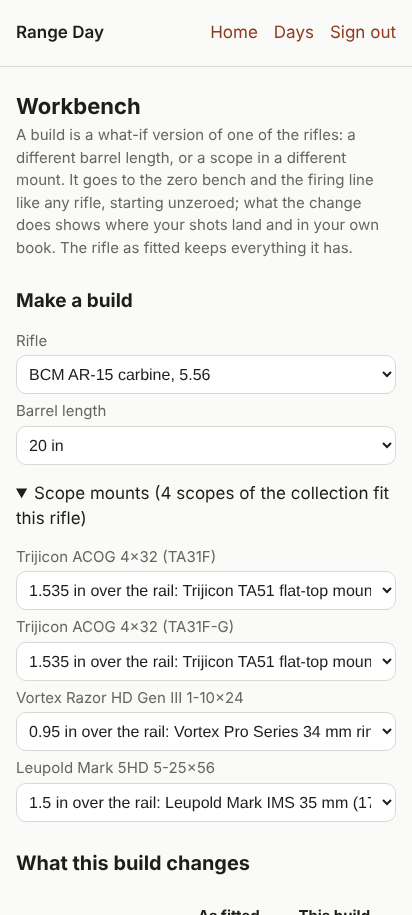 | 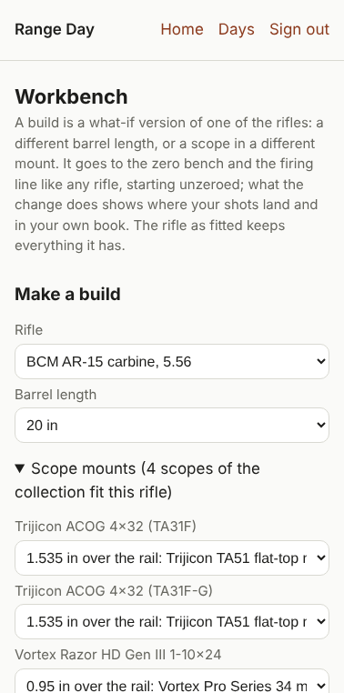 | 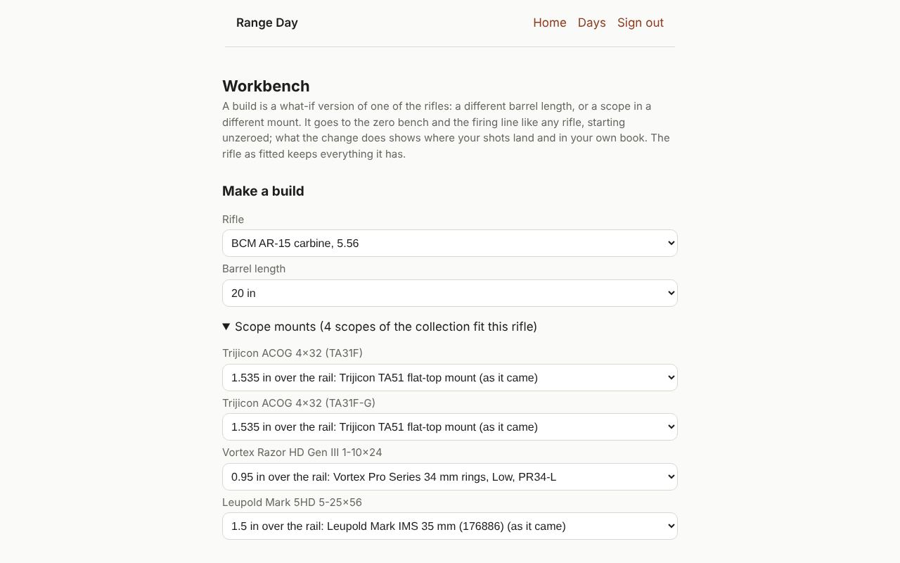 |
   | a build made | 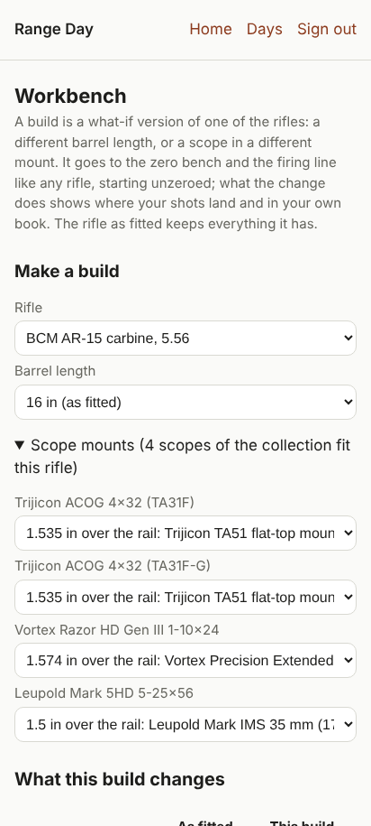 | 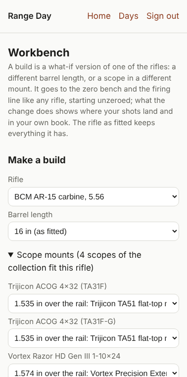 | 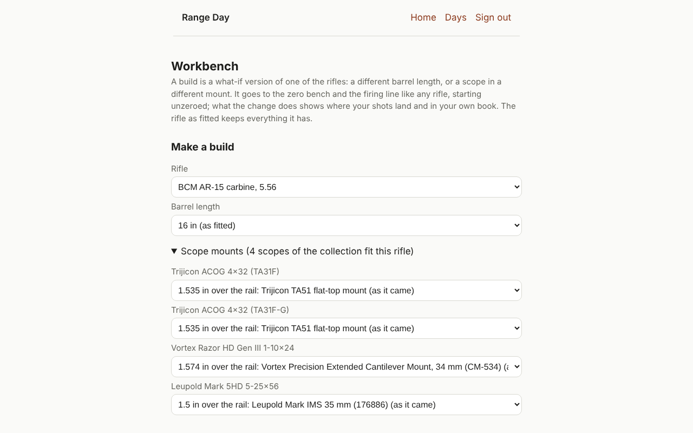 |
   | after a mistake: a build removed, with Put it back | 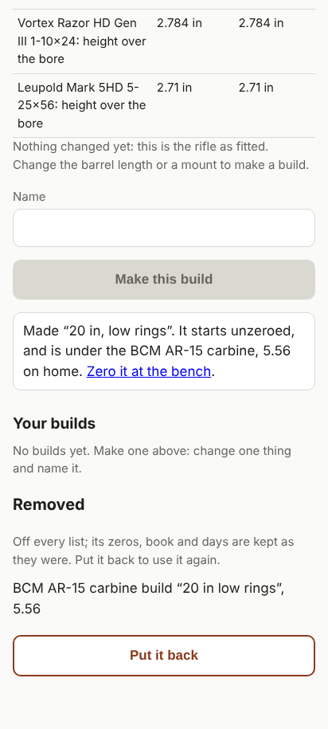 | 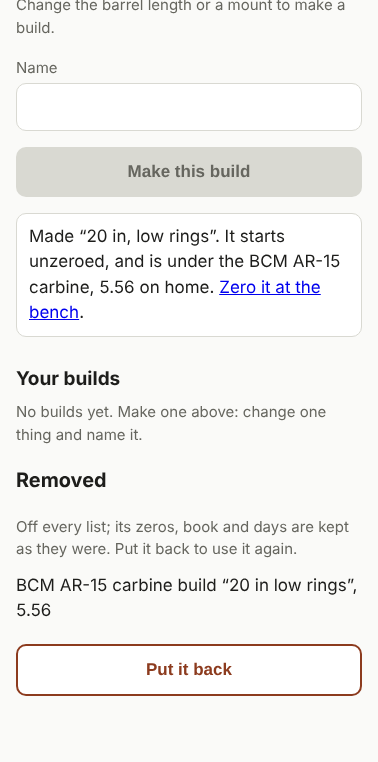 | 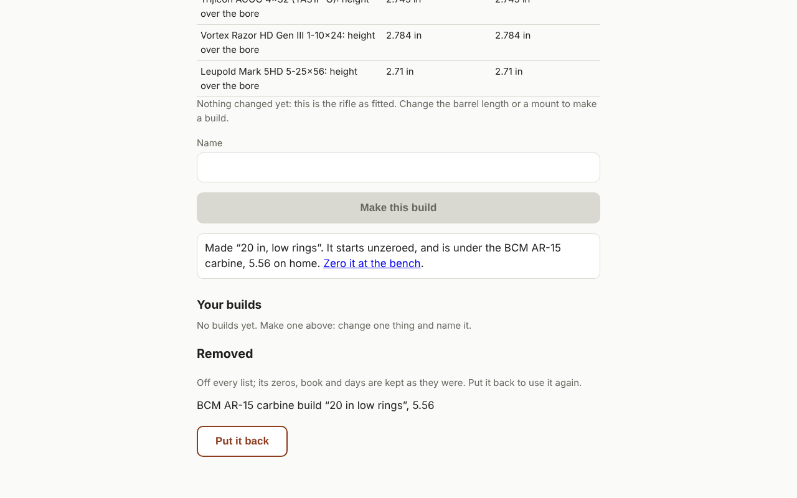 |
   | home: a rifle chooser showing a build | 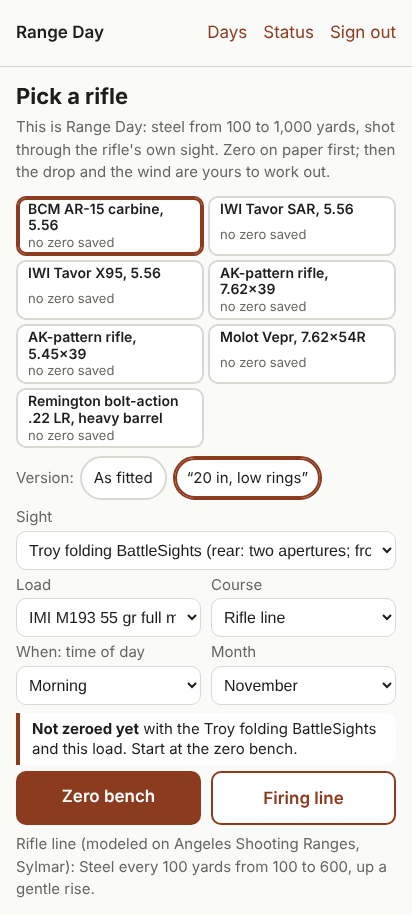 | 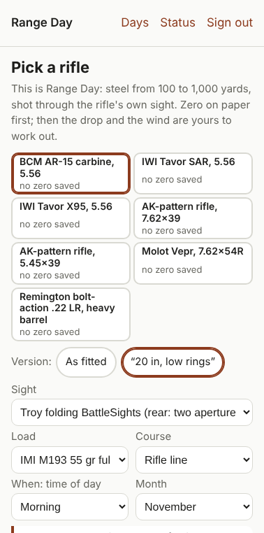 | 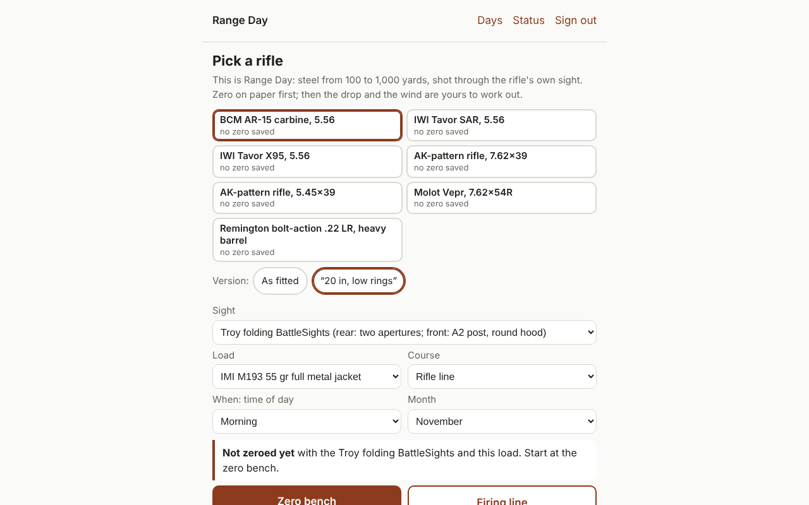 |
   | the comparison, no shots | 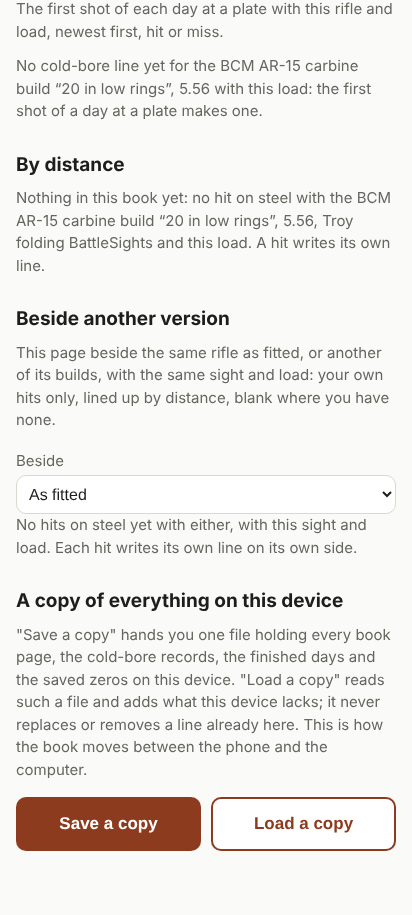 | 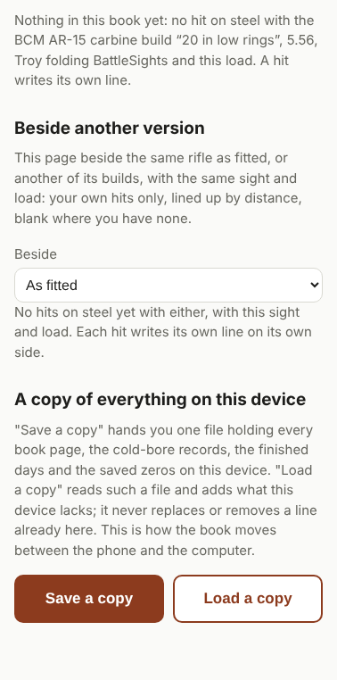 | 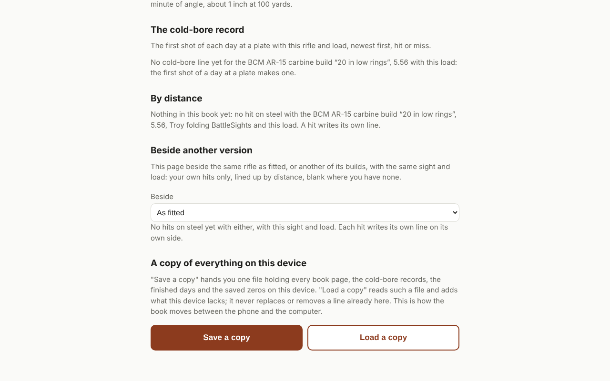 |
   | the comparison, with lines | 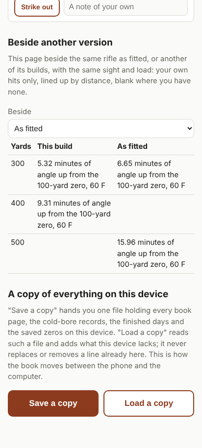 | 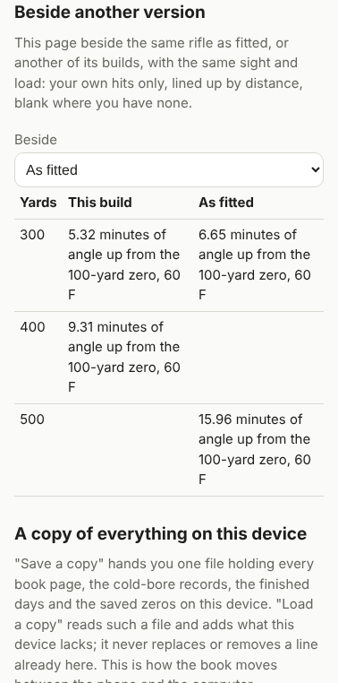 | 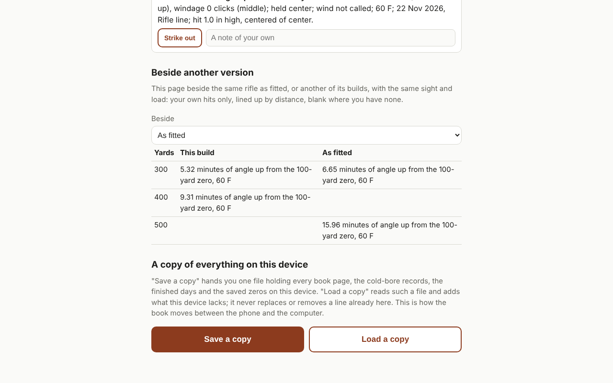 |
8. **After the deploy:** Deploy run 29
   ([46069316724](https://github.com/isleofdan/range-day/actions/runs/46069316724))
   green on `b21c9bc`; its line about the guns, word for word: "guns from
   the Spine: 12 records, 7 in the game, 5 not modeled · read in 576 ms
   (limit 5000 ms) at 2026-11-27T21:18:39Z · differs from
   data/rifles.json: none". The same run: signing in through the form
   reached the home screen, the picture file answered with 617,517 bytes,
   and the crash test answered 500. Production check: green (run 2, [46069499332](https://github.com/isleofdan/range-day/actions/runs/46069499332)): it signed in through the live sign-in form and opened the firing line in a real browser, every step passed.

Result check: jobs 20261127-204634-2d53c5 and 20261127-204900-7f9c39,
before the deploy, stood on item 8 (it waited on the deploy) and on the
notes pull request not being pushed yet (the order `CLAUDE.md` fixes);
the second also asked for the pictures to show in the report, done in the
table under item 7. Item 8 is now filled in and the notes are in their
pull request; the check of this final report is on the card.

## Asks

None. The one ask (merge and deploy) was answered with Dan's line above.

## What the next session needs

- Nothing waiting from this work. Not checked on a phone yet: the
  workbench's mount pickers show long mount names cut short in the closed
  picker (the open list shows them whole).
- The brief's later builds stand as they were: pistols, the .22's own
  scope, new loads.

## Closing message to Dan

The workbench is live. On home, under the two doors, tap **The
workbench**: pick a rifle, change the barrel length or a scope's mount,
and make the build; it then shows on home under its rifle, to zero and
shoot like any rifle. Your rifles as fitted are unchanged.

Needed from you: nothing to decide.
